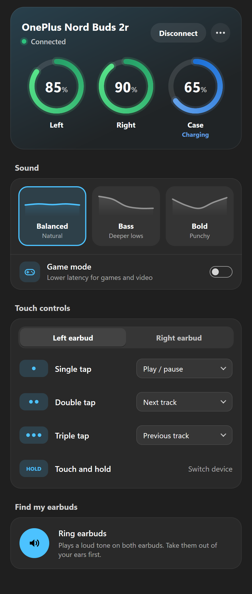

# Nord Buds companion for Windows

The Windows port of the Linux app in `../linux/`: battery, sound and touch settings for the
**OnePlus Nord Buds 2r** on Windows 10 / 11, with a notification-area (tray) icon.

- **Battery** for the left bud, right bud and case, with charging state
- **Sound profile**: Balanced, Bass, Bold
- **Game mode** (low latency) on/off
- **Touch controls** for each bud: single, double and triple tap, touch and hold
- **Find my earbuds**: rings both buds (stops by itself after 60 s)
- **Connect / disconnect** Bluetooth audio
- **Firmware** version of each bud and the case
- **Tray icon** showing the lowest bud's battery (or a plain icon), with a quick menu
- **Low-battery notification** at 15 % or less
- **Command line**: everything above from a terminal
- Light and dark mode and the Windows accent colour, sharp at any display scale

<p align="center">
  
</p>

C++20, plain Win32 + Direct2D. No runtime or DLLs to install: one `nordbuds.exe` plus the small
`nordbuds.com` command line tool.

## Build

### On Linux (cross-compile)

```bash
sudo apt install cmake g++-mingw-w64-x86-64
cd nord-buds-companion/windows
cmake -S . -B build -DCMAKE_TOOLCHAIN_FILE=cmake/mingw-w64.cmake
cmake --build build -j
```

The result is `build/nordbuds.exe` and `build/nordbuds.com`. Copy both to the same folder on the
Windows PC.

### On Windows

With Visual Studio 2022 (Desktop C++) or MinGW (WinLibs / MSYS2), from a developer prompt or PowerShell:

```bat
cmake -S . -B build
cmake --build build --config Release
```

To create the standalone Windows installer executable (`dist/NordBuds-Setup.exe` via Inno Setup):

```bat
cmake --build build --target installer
```

## Install

### Using the setup installer (recommended)

1. Pair the earbuds in **Settings → Bluetooth & devices** first.
2. Run `dist/NordBuds-Setup.exe`.
   - Installs to `%LOCALAPPDATA%\NordBuds` cleanly without requiring administrator privileges.
   - Adds a **Nord Buds** shortcut with its icon to your Start Menu.
   - Registers in Windows **Settings → Installed apps** with a clean uninstaller.
   - Offers options to create a Desktop shortcut, add to user `PATH` (for global `nordbuds` CLI commands), and start automatically with Windows.

### Manual install

1. Pair the earbuds in **Settings → Bluetooth & devices** first.
2. Put `nordbuds.exe` and `nordbuds.com` in a folder of their own, e.g. `%LOCALAPPDATA%\NordBuds`.
3. Run `nordbuds.exe`. To start it at sign-in, tick **Start with Windows** in the window's **⋯** menu.
4. Optional, for the command line: add that folder to your `PATH`.

Windows may show a SmartScreen warning the first time, because the program is not signed.

## Using it

Run **Nord Buds** to open the window. Closing the window keeps the tray icon running; **Quit** is in
the tray menu and the **⋯** menu.

| Part | What it does |
|---|---|
| Status card | name, connection state, **Connect / Disconnect**, battery rings for left, right and case |
| **⋯** menu | Start with Windows, battery level on tray icon, firmware, Bluetooth address, Bluetooth settings, Quit |
| Sound | Balanced / Bass / Bold tiles, **Game mode** switch |
| Touch controls | pick Left or Right earbud, then an action for each gesture |
| Find my earbuds | ring / stop |

When the earbuds are not connected only the status card is shown.

**Tray icon:** left-click opens the window. Right-click shows battery, sound profile, game mode,
ring, connect/disconnect and quit. The icon shows the lower of the two earbud levels with a coloured
bar (choose a plain icon with **⋯ → Battery level on tray icon**); hover it for all three levels.

## Command line

`nordbuds.com` talks to the running app (and starts it in the background if needed). In a terminal
opened in its folder, or with the folder on `PATH`, just type `nordbuds`:

```
nordbuds status
nordbuds battery
nordbuds eq bass
nordbuds game on
nordbuds find            (nordbuds find off to stop)
nordbuds touch right double next
nordbuds connect | disconnect
nordbuds tray icon | battery
nordbuds autostart on | off
nordbuds show | quit
nordbuds help
```

`--device AA:BB:CC:DD:EE:FF` (or the `NORDBUDS_DEVICE` environment variable) picks one paired device
when the name does not contain "Nord Buds".

## Settings and files

Nothing is written outside the registry:

| Where | What |
|---|---|
| `HKCU\Software\NordBuds\TrayBattery` | tray icon shows battery (1) or a plain icon (0) |
| `HKCU\Software\Microsoft\Windows\CurrentVersion\Run\NordBuds` | present when **Start with Windows** is on |

**Uninstall:** quit Nord Buds, turn off **Start with Windows** first (or delete the `Run` value), then
delete the folder and `HKCU\Software\NordBuds`.

## How it works

Same protocol and logic as the Linux app; only the platform layer differs.

- **Finding the earbuds:** a background thread reads the paired-device list
  (`BluetoothFindFirstDevice`) every 2 s and picks the device named "Nord Buds".
- **Control channel:** an RFCOMM socket (`AF_BTH`) to the vendor service UUID
  `00001107-d102-11e1-9b23-00025b00a5a5`; Windows finds the channel over SDP. A reader thread
  passes incoming bytes to the UI thread, which runs the protocol (`protocol.cpp`, `buds.cpp`).
- **Connect / disconnect:** asks the Windows Bluetooth audio driver to reconnect or disconnect the
  device (the same request Settings makes). Because the control channel itself keeps the Bluetooth
  link up, Disconnect closes it first and does not reopen it until Windows reports the buds gone.
- **Disconnects:** battery and settings are cleared the moment the link drops; if the buds stop
  answering for about 2 minutes the link is treated as dead.
- **UI:** drawn with Direct2D/DirectWrite, follows light/dark mode and the accent colour, and is
  per-monitor DPI aware.

## Status

Built and checked here by cross-compiling, and by rendering the window offscreen under Wine in every
state (connected, charging/low, ringing, connecting, error, not connected, no earbuds, Bluetooth off).

**Not yet tested on a real Windows PC with the earbuds.** The Bluetooth parts (device detection,
RFCOMM channel, connect/disconnect through the audio driver) and the tray icon need a first run on
Windows. If something does not work, `nordbuds status` shows the last error.

## Project layout

```
nord-buds-companion/windows/
├── CMakeLists.txt
├── cmake/mingw-w64.cmake  cross-compile toolchain
├── res/                   app icon (.svg, .ico), manifest, resource script
└── src/
    ├── main.cpp           app, tray service, commands from nordbuds.com
    ├── cli.cpp            nordbuds.com, the command line front end
    ├── ipc.h              WM_COPYDATA messages between the two
    ├── buds.{h,cpp}       device link: discovery, RFCOMM, startup sequence, state
    ├── bluetooth.{h,cpp}  paired devices, RFCOMM socket, audio connect/disconnect
    ├── protocol.{h,cpp}   frame encode/decode (same as Linux)
    ├── model.{h,cpp}      Nord Buds 2r presets and touch options (same as Linux)
    ├── window.{h,cpp}     main window (Direct2D)
    ├── gfx.{h,cpp}        theme, fonts, earbuds glyph, tray icon drawing
    ├── tray.{h,cpp}       notification-area icon and menu
    ├── settings.{h,cpp}   registry settings
    └── util.{h,cpp}       UTF-8/UTF-16, error text, threads
```
